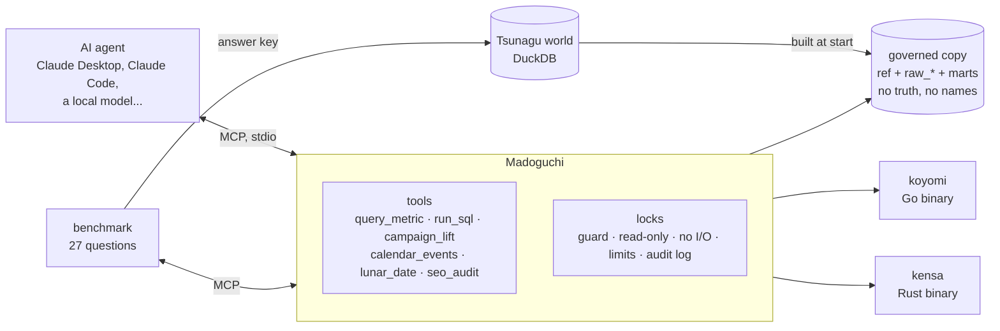

# Madoguchi 窓口

[](https://github.com/thibaultbordrie-cloud/madoguchi/actions/workflows/ci.yml)


**A read-only MCP server that gives AI agents governed access to CRM data, a commercial calendar and an SEO auditor, and a benchmark that scores those agents against a known answer key.**

*Madoguchi* is the service window of a Japanese office: one counter, clear rules, nothing goes behind it. Here the agent is on one side; on the other side are three tools I built in three languages:

- [**Tsunagu**](https://github.com/thibaultbordrie-cloud/tsunagu) (Python): a fictional cross-border CRM world (France, Japan, Taiwan), with the hidden truth of why every order happened;
- [**Koyomi**](https://github.com/thibaultbordrie-cloud/koyomi) (Go): the commercial calendar of Japan, Taiwan, Korea and France, computed from astronomy;
- [**Kensa**](https://github.com/thibaultbordrie-cloud/kensa) (Rust): a multilingual and AI-search SEO auditor.

[日本語](#日本語での概要) · [繁體中文](#中文簡介繁體) · [Français](#en-bref-français)

## Why

Connecting an agent to company data raises two questions before any demo: **what is the worst it can do**, and **how often is it right**. Madoguchi answers both with tests, not promises.

- It hands the agent a governed copy: no answer key, no names, pseudonymised identifiers, read-only, no file or network access, bounded queries, every call logged. `madoguchi check` tries 23 ways around these locks and fails if one works.
- It ships a benchmark whose answers are computed independently of the server. A script that uses only the tools must score 100 % on every push, so the tools are proven right; then any model can be measured on the same questions.



## Quick start

Node 20.10 or later, Python 3.11 or later for Tsunagu.

```bash
git clone https://github.com/thibaultbordrie-cloud/madoguchi.git && cd madoguchi
npm ci && npm run build

python -m pip install "tsunagu @ git+https://github.com/thibaultbordrie-cloud/tsunagu"
tsunagu generate --out data/tsunagu.duckdb          # the two-year world, about 20 s

node dist/src/cli.js check --tsunagu data/tsunagu.duckdb
npm link                                            # optional: a `madoguchi` command
```

Koyomi and Kensa are optional: download them from their releases ([Koyomi](https://github.com/thibaultbordrie-cloud/koyomi/releases), [Kensa](https://github.com/thibaultbordrie-cloud/kensa/releases)) and point to them in a configuration file such as [`madoguchi.example.json`](madoguchi.example.json).

**Claude Desktop**: add to `claude_desktop_config.json`, with absolute paths:

```json
{
  "mcpServers": {
    "madoguchi": {
      "command": "node",
      "args": ["/path/to/madoguchi/dist/src/cli.js", "serve", "--config", "/path/to/madoguchi.json"]
    }
  }
}
```

**Claude Code**: `claude mcp add madoguchi -- node /path/to/madoguchi/dist/src/cli.js serve --config /path/to/madoguchi.json`

Then ask, for example: *"Did our French e-mails really sell anything over the last two years?"*

## Tools

| Tool | What it does |
|---|---|
| `describe_data` | period, markets, tables, the metric catalogue, what was removed for privacy |
| `query_metric` | 12 metrics with one definition each (orders, buyers, gross revenue in EUR, average basket, last-click share, open rate with and without Apple MPP, click rate…), split by market, month, channel, theme or UTM source |
| `run_sql` | one guarded DuckDB SELECT, at most 200 rows, 15 s |
| `campaign_lift` | recipients against holdout groups: uplift with a 95% interval, incremental orders, and what last-click credits, for contrast |
| `calendar_events`, `lunar_date` | Koyomi: 春節, 설날, 中秋, 節分, 土用の丑の日, soldes… for any date range |
| `seo_audit` | Kensa on an allowed host only |

A resource (`madoguchi://catalogue`) and a prompt (`weekly_brief`) come with them.

The tool that matters most is `campaign_lift`. On the two-year world, for French e-mails:

```json
{
  "recipients": 907147, "holdouts": 48097,
  "uplift_pts": 0.042, "uplift_ci95_pts": [-0.022, 0.106],
  "incremental_orders_ci95": [-197.6, 962.7],
  "last_click_orders": 755,
  "verdict": "The holdout cannot tell the effect from zero: the 95% interval goes from -198 to 963 incremental orders. Last-click credits 755 orders, which says nothing about cause."
}
```

The simulation's hidden answer is 488 orders: inside the interval, and far from the 755 that last-click attribution would report. An agent that answers "755" is confident and wrong; the benchmark catches it.

## Security

Seven locks, each tested on every push. Details and limits: [docs/SECURITY_MODEL.md](docs/SECURITY_MODEL.md).

1. **No answer key**: the `truth` schema is never copied.
2. **No personal data**: names dropped; e-mail addresses and LINE ids replaced by salted pseudonyms, new at every start. A new column that looks personal stops the build until it has a rule.
3. **One SELECT only**: the agent's SQL is parsed by DuckDB itself (`json_serialize_sql`) before it runs.
4. **Read-only, no I/O**: even a SELECT cannot read a file, attach a database, load an extension or reach the network; the configuration is locked.
5. **Bounds**: time limit, row limit, two threads.
6. **No injection**: tool arguments are checked against fixed lists and bound as parameters.
7. **A trace**: every call logged, without its results.

```text
$ madoguchi check --tsunagu data/tsunagu.duckdb
ok    no truth schema in the governed copy
ok    no e-mail address in any text column  (0 found)
ok    guard: DDL (CREATE TABLE)  (only SELECT statements are allowed)
ok    engine: read a file with read_csv  (Permission Error: ... file system operations are disabled)
ok    engine: re-enable file access  (Invalid Input Error: Cannot change configuration option ...)
ok    a runaway query is stopped by the time limit  (the query was stopped after 2 s)
...
23/23 locks hold
```

## Benchmark

27 questions in six categories (KPIs, comparisons, causal effects, privacy, calendar, SEO), answered from sources independent of the server: plain SQL on the raw tables, the simulation's hidden truth, the `holidays` package, Kensa's answer key. Details: [docs/EVAL.md](docs/EVAL.md).

```bash
madoguchi eval --config madoguchi.json --runner oracle                    # the tools alone: 27/27 with Koyomi and Kensa
madoguchi eval --config madoguchi.json --runner openai --model qwen3:8b   # a local model through Ollama
madoguchi eval --config madoguchi.json --runner replay --answers a.jsonl  # any agent, scored by hand
```

Scoring is strict where it matters: an interval must contain the truth and stay narrow; `UNKNOWN` is right only when the data cannot answer (personal data, what LINE caused), and wrong everywhere else.

## Develop

```bash
npm run build
MADOGUCHI_TEST_DB=data/tiny.duckdb npm test     # tsunagu generate --scenario tiny --out data/tiny.duckdb
# optional: MADOGUCHI_TEST_KOYOMI=bin/koyomi MADOGUCHI_TEST_KENSA=bin/kensa
```

CI runs the tests on Linux, macOS and Windows, then downloads Koyomi and Kensa from their releases and runs the oracle on the two-year world. Three dependencies: the official MCP SDK, DuckDB and zod.

## Limits

- **Fictional data only.** The locks are designed for real data, but the project has only been run on Tsunagu.
- **A pseudonym is stable within a session**, so an agent can follow one customer. Aggregate-only tools would be the next step for real customer data.
- **The benchmark is small** (27 questions): enough to catch a broken tool or a careless agent, not to rank close models.
- **No model results are published**: run your own; the numbers depend on the model and the machine.

## 日本語での概要

Madoguchi（窓口）は、AIエージェントにCRMデータ・商戦カレンダー・SEO監査ツールへの「安全な窓口」を提供する読み取り専用の MCP サーバーです（TypeScript）。エージェントが見るのは、正解データ（truth）と氏名を除き、メールアドレスと LINE ID を仮名化したコピーだけです。SQL は SELECT 1文のみ、ファイル・ネットワークへのアクセスは不可、時間と行数に上限があり、すべての呼び出しが記録されます。`madoguchi check` が 23 通りの突破方法を試し、すべて防がれることを確認します。さらに、サーバーとは独立に答えを計算した 27 問のベンチマークで、エージェントの正確さを測れます。ラストクリックの数字を「効果」と答えるエージェントは、ここで不正解になります。

## 中文簡介（繁體）

Madoguchi（窓口）是一個唯讀的 MCP 伺服器（TypeScript），讓 AI 代理安全地存取 CRM 資料、行銷行事曆與 SEO 稽核工具。代理只看得到一份受控的副本：沒有模擬的標準答案（truth）、沒有姓名，電子郵件與 LINE ID 都經過假名化；SQL 只能是一條 SELECT，不能讀檔案或連網，有時間與筆數上限，每次呼叫都有紀錄。`madoguchi check` 會嘗試 23 種繞過方式，確認全部被擋下。另附 27 題的評測，答案獨立於伺服器計算，用來衡量代理到底答對多少。把最終點擊歸因當成「成效」的代理，在這裡會被判錯。

## En bref (français)

Madoguchi (窓口, « le guichet ») est un serveur MCP en lecture seule, écrit en TypeScript, qui donne à des agents IA un accès encadré à des données CRM, à un calendrier commercial et à un auditeur SEO. L'agent ne voit qu'une copie gouvernée : sans le corrigé de la simulation, sans noms, avec des e-mails et des identifiants LINE pseudonymisés ; une seule requête SELECT à la fois, aucun accès aux fichiers ni au réseau, des limites de temps et de lignes, et chaque appel est journalisé. `madoguchi check` tente 23 façons de contourner ces verrous et échoue si l'une passe. Un banc d'essai de 27 questions, dont les réponses sont calculées indépendamment du serveur, mesure la justesse des agents : celui qui présente le dernier clic comme un effet est compté faux.

## License

MIT.
